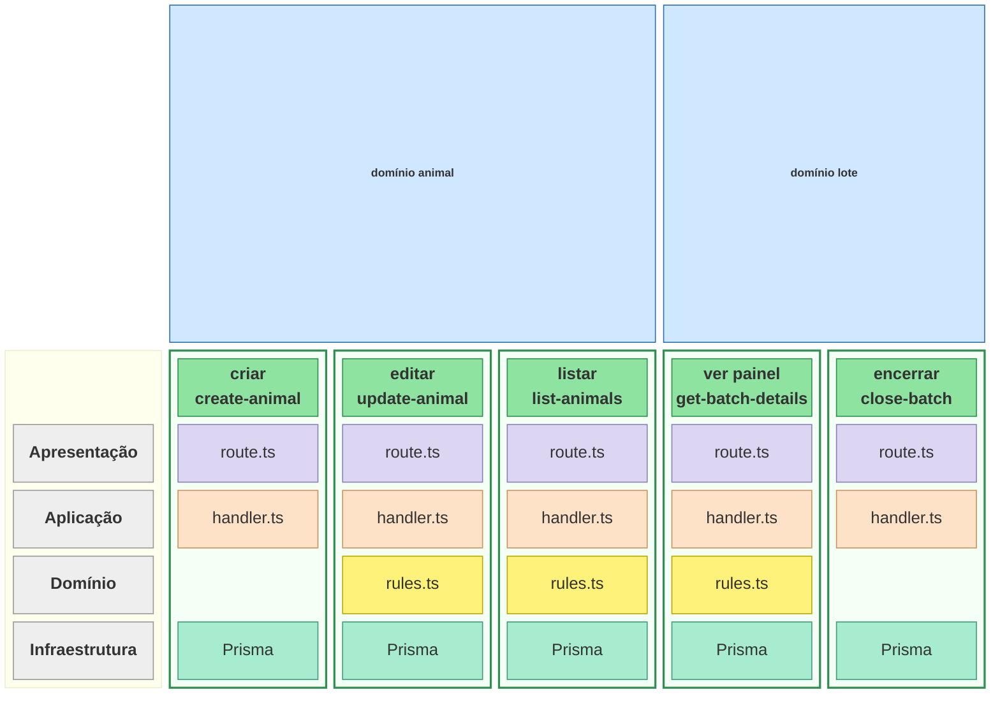
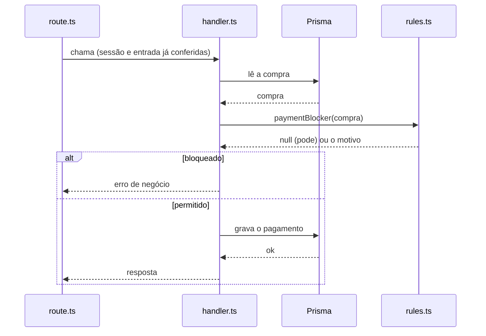
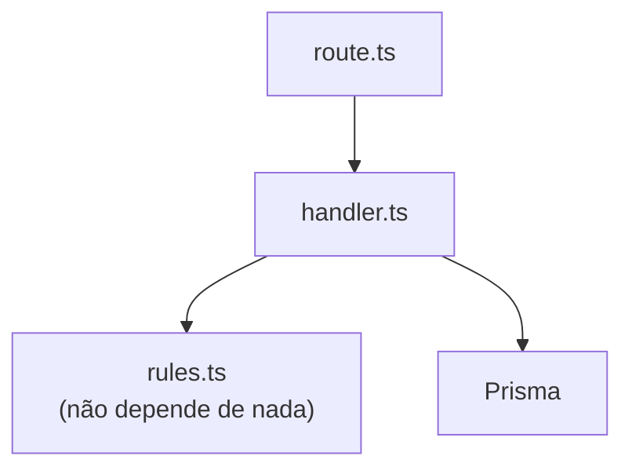

# Fatias da API

A API (`apps/api`) é organizada em fatias verticais: cada operação tem a própria pasta em
`src/features/<domínio>/<operação>/` e leva consigo o seu pedaço de cada camada técnica.

## Fatias × camadas

Cada coluna é uma fatia (uma operação), agrupada no seu domínio; as linhas são as camadas. O
diagrama mostra **que código pertence a cada operação**, não a ordem das chamadas (ver
[Sequência](#sequência-de-uma-requisição)) nem quem depende de quem (ver
[Dependências](#dependências)). As fatias são exemplos reais; a célula vazia em `rules` é de uma
fatia sem regra.

- **Apresentação** — `route.ts`: sessão e permissão (`requireSession`), validação da entrada com o
  schema do `@ifarm/shared`, resposta JSON e conversão de erros (`errorResponse`).
- **Aplicação** — `handler.ts`: a operação inteira (Transaction Script): lê, decide e grava,
  numa transação quando grava.
- **Domínio** — `rules.ts`: decisões com lógica de verdade, em funções puras e testadas
  (`rules.test.ts`). Fica na fatia quando só ela usa; no domínio, quando mais de uma usa.
- **Infraestrutura** — o Prisma, usado direto pelo handler (sem repositório).

Nem toda fatia ocupa todas as camadas: uma fatia sem regra (como criar animal e encerrar lote)
não tem nada em `rules`.

## Sequência de uma requisição

Com regra, o handler fica no centro: lê os dados, entrega às regras e grava conforme a resposta.
As regras nunca acessam o banco.

Sem regra, o caminho é só `route.ts → handler.ts → Prisma`.

## Dependências

É o formato em cebola (Onion/Clean) aplicado de forma leve: o domínio não depende da
infraestrutura, e quem orquestra os dois é o handler ("functional core, imperative shell").

## Fronteiras

- **Dentro da pasta de uma fatia**: só daquela fatia.
- **No nível do domínio** (`shared.ts`, `rules.ts`, módulos com nome como `costs.ts`): comum às
  fatias do domínio.
- **`*.public.ts`**: o que outros domínios podem importar.

As regras de lint `ifarm/slice-boundary` e `ifarm/domain-boundary` (`apps/api/eslint.config.mjs`)
garantem essas fronteiras.
