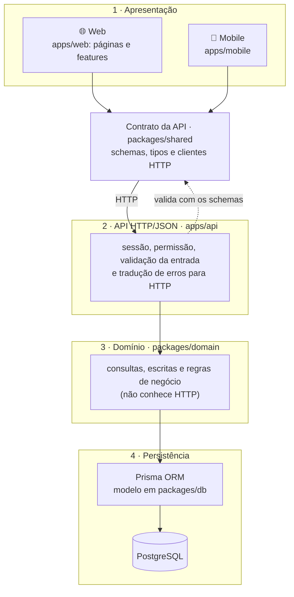
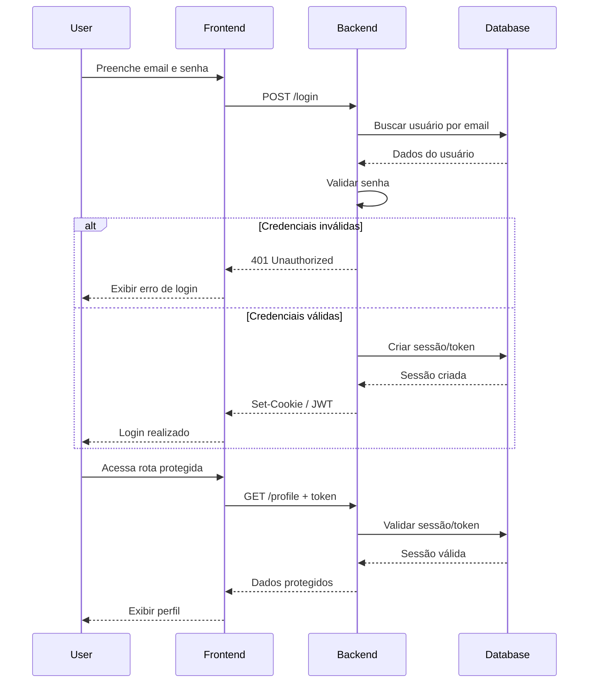

# Arquitetura

A arquitetura da plataforma segue o modelo de Arquitetura em Camadas (Layered Architecture), priorizando desacoplamento entre interfaces, manutenibilidade e centralização das regras de negócio.

O sistema adota uma API centralizada, responsável por autenticação, autorização, processamento das regras de negócio e acesso aos dados. A plataforma web e os aplicativos móveis são clientes dessa mesma API.

A estrutura é dividida em quatro camadas. Cada camada depende apenas da camada abaixo dela: a apresentação nunca acessa diretamente as regras de negócio nem o banco de dados. Entre a apresentação e a API há um contrato compartilhado (`packages/shared`), usado pelos dois lados para que ambos falem a mesma língua.

## 1 - Camada de Apresentação

Responsável pela interação direta com os usuários. É composta por aplicações independentes que consomem a API central por meio dos clientes HTTP do contrato. Esta camada não contém regras de negócio: ela exibe o que a API decide (situações, bloqueios e motivos) e, no máximo, antecipa validações para orientar o usuário antes do envio.

- (i) Plataforma Web (`apps/web`: páginas em `src/app/(protected)`, componentes em `src/features` e `src/components`): aplicação utilizada para operações administrativas, monitoramento, visualização de indicadores, relatórios e gerenciamento geral do sistema. O `src/proxy.ts` faz uma verificação prévia de sessão e de perfil antes de exibir cada página; a autorização definitiva é feita pela API. As chamadas a `/api` feitas pelo navegador são repassadas à API pelo próprio web (`next.config.ts`), de modo que as duas aplicações ficam na mesma origem.

- (ii) Aplicativos Móveis (`apps/mobile`, Android/iOS): aplicações destinadas às operações em campo, projetadas para a estratégia offline-first, permitindo registros locais e sincronização posterior dos dados com a API quando houver conectividade.

## 2 - Camada de API (HTTP/JSON)

Porta de entrada do sistema (`apps/api`, construída com o framework Hono e executada separadamente da plataforma web). Cada rota recebe a requisição, verifica a sessão do usuário, aplica o controle de acesso, valida os dados de entrada com os schemas do contrato e delega a operação à camada de domínio. Ao final, converte o resultado, ou o erro, na resposta HTTP correspondente.

A autenticação é feita pelo better-auth, que gerencia sessões baseadas em cookie; o servidor de autenticação fica na API (`apps/api/src/auth.ts`), e cada aplicação cliente usa o cliente do better-auth para entrar e sair. A autorização segue o controle de acesso baseado em funções (RBAC): a tabela `RESOURCE_ACCESS` (`packages/shared/src/permissions.ts`) define, para cada recurso, os perfis sem acesso, garantindo que cada perfil acesse apenas os recursos autorizados. A API aplica essa tabela em cada requisição; as aplicações clientes a usam apenas para não exibir o que o perfil não pode acessar.

Esta camada não contém regras de negócio nem acessa o banco de dados, com uma exceção: o better-auth grava usuários e sessões diretamente no banco, por meio do adaptador do Prisma.

## 3 - Camada de Domínio (Regras de Negócio)

Centraliza as regras de negócio do sistema (`packages/domain`). Cada domínio (pessoas, lotes, compras, manejos...) é organizado em consultas (`queries`), operações de escrita (`mutations`) e regras puras (`rules`), estas últimas cobertas por testes automatizados.

O código desta camada é executado exclusivamente no servidor e não conhece HTTP: comunica falhas por meio de erros do próprio domínio (registro não encontrado, validação, conflito, regra de negócio violada), que a camada de API traduz em respostas. Por isso, as mesmas regras podem ser reutilizadas fora das rotas, como na carga inicial de dados e em scripts de manutenção.

## 4 - Camada de Persistência

Banco de dados relacional (PostgreSQL) encarregado do armazenamento seguro e persistente de todas as entidades do sistema.

O Prisma ORM atua como intermediário entre a camada de domínio e o banco de dados, abstraindo as operações SQL por meio de uma interface tipada e segura. O modelo de dados é definido em `packages/db/prisma/schema.prisma`, e apenas a camada de domínio acessa o banco. Detalhes de armazenamento, como o formato das datas gravadas, também ficam restritos a essa camada.

## Contrato da API

O pacote `packages/shared` define o contrato entre a apresentação e a API: os schemas de validação dos dados enviados, os tipos das respostas e os clientes HTTP de cada recurso. A plataforma web e os aplicativos móveis usam os mesmos clientes, e a API valida as requisições com os mesmos schemas. Assim, as duas pontas permanecem sempre consistentes.

Como todo o conteúdo do contrato é incluído nas aplicações cliente, ele contém apenas o que o cliente precisa executar e que pode ser exposto: validações de formulário, simulações interativas e o vocabulário de situações exibido nas telas. As regras de decisão, os cálculos de valores e os detalhes de persistência permanecem no servidor. O contrato não depende do banco de dados nem de recursos exclusivos do servidor.

## 5 - Fluxo de Autenticação

