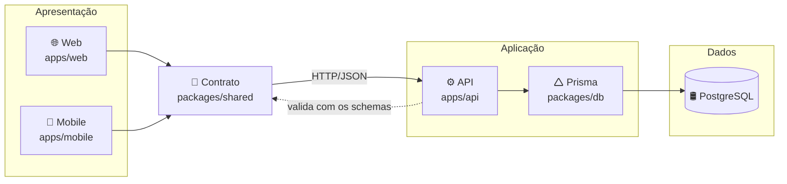
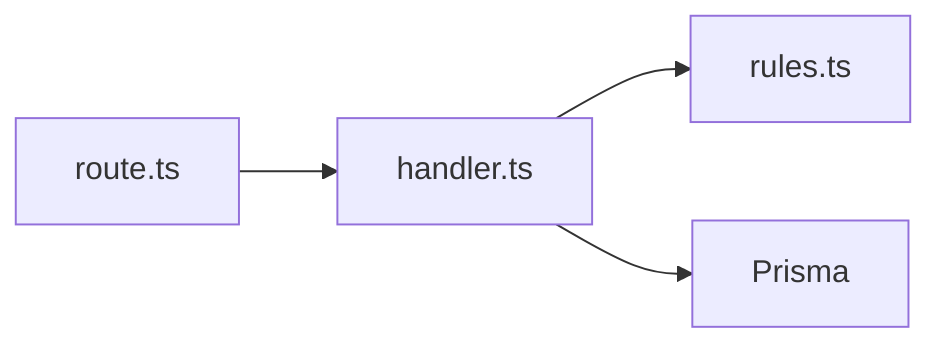
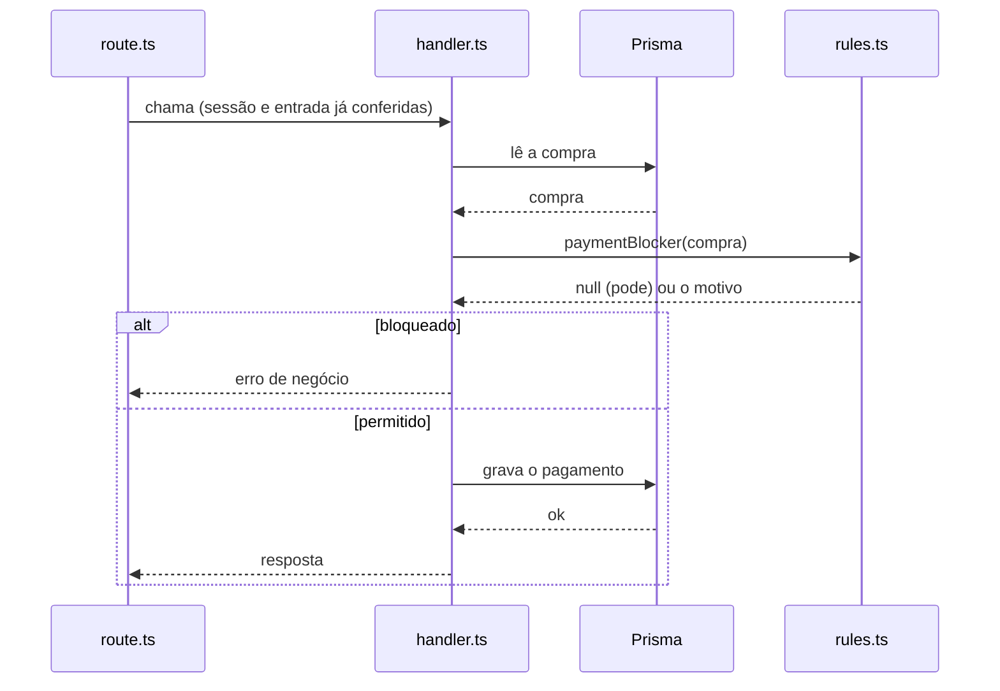

# Arquitetura

O projeto segue uma arquitetura em três camadas físicas (_three-tier architecture_): os clientes (web e mobile) na apresentação, a API na aplicação e o PostgreSQL nos dados. A API concentra as regras de negócio e o acesso aos dados; a plataforma web e o aplicativo móvel só exibem e enviam dados, falando com a API por um contrato compartilhado.



O monorepo do projeto está organizado como abaixo:

| Pacote            | Papel                                                      |
| ----------------- | ---------------------------------------------------------- |
| `apps/api`        | API HTTP/JSON (Hono): regras de negócio e acesso aos dados |
| `apps/web`        | plataforma web (React)                                     |
| `apps/mobile`     | aplicativo móvel (Expo / React Native)                     |
| `packages/shared` | contrato entre os clientes e a API                         |
| `packages/db`     | modelo de dados (Prisma) e acesso ao PostgreSQL            |

## Clientes

A plataforma web e o aplicativo móvel são clientes da mesma API. Eles não contêm regras de
decisão: exibem o que a API decide (situações, bloqueios, motivos) e, no máximo, antecipam
validações para orientar o usuário antes do envio.

No web, cada domínio tem as suas telas em `src/features/<domínio>`; as páginas (`src/pages`) só
montam essas telas.

## Contrato (`packages/shared`)

O contrato é a língua comum entre os clientes e a API. Para cada domínio:

| Arquivo     | Conteúdo                                                                     |
| ----------- | ---------------------------------------------------------------------------- |
| `schema.ts` | o que o cliente envia: schemas de validação (Zod) e os tipos derivados deles |
| `types.ts`  | o que a API responde: os tipos das respostas                                 |
| `client.ts` | as funções que chamam a API                                                  |

Os clientes validam os formulários com os mesmos schemas que a API usa para validar as
requisições, e a API tipa as respostas com os mesmos tipos que os clientes usam para exibi-las.
Assim, os dois lados não divergem.

Tudo no contrato é executado também nos clientes, então é público: ele não depende do banco nem
do servidor, e contém só o que o cliente precisa (validação, tipos e as poucas regras que as
telas executam). Decisões de negócio, cálculos de valores e detalhes de persistência ficam na
API.

## API (`apps/api`)

A API é organizada em **fatias verticais** (Vertical Slice Architecture): cada operação do
sistema tem a própria pasta, que reúne tudo de que ela precisa. As fatias são agrupadas por
domínio (pessoas, áreas, lotes, animais, compras, sessões de manejo...).

```
src/features/
  <domínio>/
    <operação>/
      route.ts      o endpoint HTTP
      handler.ts    a operação
    routes.ts       monta as fatias do domínio em /api/<domínio>
    rules.ts        decisões de negócio puras
    shared.ts       código comum às fatias do domínio
    <assunto>.ts    módulos internos com nome próprio
    *.public.ts     o que outros domínios podem usar
```

### Dentro de uma fatia

Cada fatia segue o padrão **Transaction Script** (Martin Fowler, _Patterns of Enterprise
Application Architecture_): a operação inteira fica num único procedimento, o handler, que lê,
decide e grava. As decisões com lógica de negócio são extraídas para funções puras.
<!-- no formato **functional core, imperative shell** (Gary Bernhardt), também chamado de _impureim sandwich_ (Mark Seemann). -->

| Arquivo      | Camada       | Responsabilidade                                                                                      |
| ------------ | ------------ | ----------------------------------------------------------------------------------------------------- |
| `route.ts`   | apresentação | recebe a requisição, confere o acesso, valida a entrada com o schema do contrato e devolve a resposta |
| `handler.ts` | aplicação    | executa a operação inteira: lê os dados, decide e grava, numa transação quando grava                  |
| `rules.ts`   | domínio      | decisões com lógica de negócio, em funções puras e testadas                                           |
| Prisma       | persistência | acesso ao banco, usado diretamente pelo handler                                                       |

O handler segue o formato **ler → decidir → gravar**: busca os dados, entrega às regras e grava
conforme a resposta. As regras não acessam o banco, por isso podem ser testadas sem ele. Nem toda
fatia tem regras: uma operação simples vai direto do handler ao banco.



Numa requisição, com o exemplo de pagar uma compra:



### Fronteiras

| Onde fica o código                                              | Quem pode usar       |
| --------------------------------------------------------------- | -------------------- |
| dentro da pasta de uma fatia                                    | só aquela fatia      |
| no nível do domínio (`rules.ts`, `shared.ts`, módulos com nome) | as fatias do domínio |
| `*.public.ts`                                                   | qualquer domínio     |

Duas regras de lint (`ifarm/slice-boundary` e `ifarm/domain-boundary`, em
`apps/api/eslint.config.mjs`) garantem essas fronteiras. Fora dos domínios ficam só a montagem do
servidor (`src/index.ts`), o que é comum a todos os `route.ts` (`src/http.ts`, `src/session.ts`) e
utilitários sem HTTP (`src/lib`).

## Persistência (`packages/db`)

O banco é o PostgreSQL, acessado pelo Prisma. O modelo de dados fica em
`packages/db/prisma/schema.prisma`, e o pacote exporta o cliente e a instância do banco. Só a API
acessa o banco.
