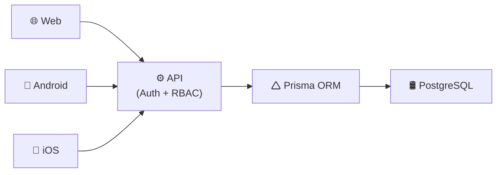

# Arquitetura

A arquitetura da plataforma segue o modelo de Arquitetura em Camadas (Layered Architecture), priorizando desacoplamento entre interfaces, escalabilidade, manutenibilidade e centralização das regras de negócio.

O sistema adota uma abordagem baseada em uma API centralizada, responsável por autenticação, autorização, processamento das regras de negócio e acesso aos dados.

A estrutura é dividida em três camadas principais, como mostrado a seguir.

## 1 - Camada de Apresentação (Interfaces com o Usuário): 
Responsável pela interação direta com os usuários e dispositivos externos. É composta por aplicações independentes que consomem os serviços disponibilizados pela API central.

- (i) Plataforma Web: Aplicação utilizada para operações administrativas, monitoramento estratégico, visualização de indicadores, relatórios e gerenciamento geral do sistema.

- (ii) Aplicativos Móveis (Android/iOS): Aplicações destinadas às operações em campo, projetadas com suporte à estratégia offline-first, permitindo registros locais e sincronização posterior dos dados com a API quando houver conectividade.

## 2 - Camada de Negócios (API Centralizada e Segurança)
Responsável pela centralização das regras de negócio, autenticação, autorização e processamento das operações do sistema.

A API aplica mecanismos de autenticação e controle de acesso, sendo responsável pelo gerenciamento de sessões e aplicação das regras de controle de acesso baseado em funções (RBAC), garantindo que cada perfil possua acesso apenas aos recursos autorizados.

## 3 - Camada de Persistência e Acesso a dados
Banco de dados relacional robusto encarregado do armazenamento seguro e persistente de todas as entidades do sistema.

O Prisma ORM atua como camada intermediária entre a API e o BD, abstraindo operações SQL através de uma interface tipada e segura, facilitando manutenção, produtividade e integridade das operações.

