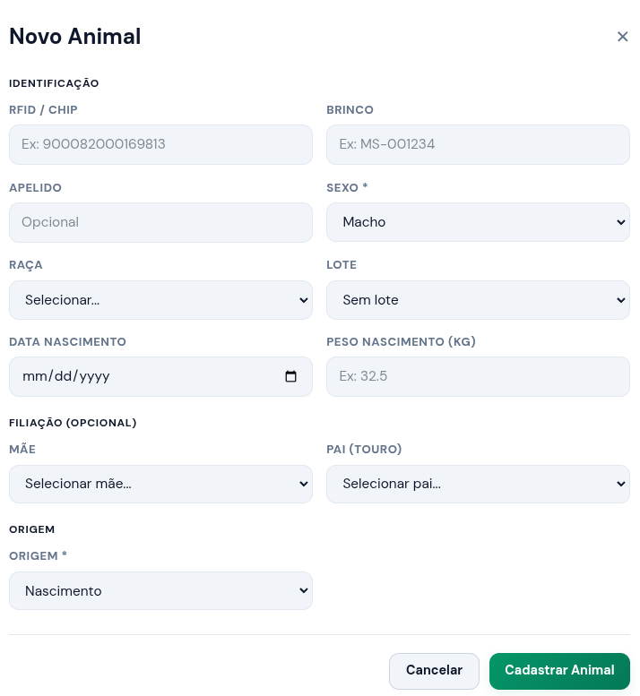

# 📦 Módulo: `MOD-ANIMAL`

Módulo responsável pelo ciclo de vida completo dos animais na plataforma (Criação, Consulta, Visualização, Atualização e Remoção).

| Campo        | Tipo    | Descrição |
| ------------ | ------- | --------- |
| `nome`       | Texto   | ...       |
| `especie`    | Seleção | ...       |
| `nascimento` | Data    | ...       |

# 1 - Regras de Negócio do Módulo (RN)

- **`RN-ANIMAL-01` - Identificação Única:** Todo animal cadastrado deve possuir uma identificação única no sistema, seja através de brinco numérico visual, tatuagem ou ID do chip RFID.
- **`RN-ANIMAL-02` - Validação de Idade por Fase:** Um animal não pode ser alocado na fase de "Engorda" se sua idade cronológica for inferior a X meses, salvo se houver sobreposição manual justificada pelo Gerente.

# 2 - Requisitos Funcionais (RF)

## 2.1 - `RF-ANIMAL-01`: Criar Animal

### 2.1.1 - Descrição

Permitir o cadastro e atualização de animais para gerenciamento do ciclo produtivo.

| Tipo                  | Valor                                                                                                                                                 |
| :-------------------- | :---------------------------------------------------------------------------------------------------------------------------------------------------- |
| **User Story**        | Como um **Gerente** ou **Administrador**, quero **cadastrar um novo animal** no sistema para que ele possa ser rastreado e gerido no ciclo produtivo. |
| **Dependências**      | `RF-LOTE-01`                                                                                                                                          |
| **Regras Vinculadas** | `RN-ANIMAL-01`, `RN-ANIMAL-02`                                                                                                                        |
| **Atores**            | Administrador, Gerente                                                                                                                                |
| **Plataformas**       | Web                                                                                                                                                   |

### 2.1.2 - Critérios de Aceitação (Checklist de Homologação)

- [ ] O sistema deve impedir o salvamento se os campos obrigatórios (_data_nascimento_ e _fase_ciclo_) não estiverem preenchidos.
- [ ] O sistema deve validar em tempo real se o `codigo_brinco` ou `id_rfid` informado já não existe na base de dados ativa.
- [ ] Após o cadastro bem-sucedido, o usuário deve ser redirecionado para a tela de visualização do animal com uma mensagem de sucesso.

### 2.1.3 - Cenários de Uso (Fluxo de Interação BDD)

**Cenário 1: Cadastro realizado com sucesso (Fluxo Principal)**

- **Dado que** o Gerente está na tela de cadastro de animais e preencheu todos os dados obrigatórios corretamente;
- **Quando** ele clicar no botão "Salvar Cadastro";
- **Então** o sistema deve persistir os dados no banco de dados, registrar o log de criação e exibir a mensagem: _"Animal cadastrado com sucesso!"_.

**Cenário 2: Tentativa de cadastro com brinco duplicado (Fluxo de Exceção)**

- **Dado que** o código de brinco `BR-1010` já pertence a um animal ativo na fazenda;
- **Quando** o Gerente tentar cadastrar um novo animal usando o mesmo código `BR-1010`;
- **Então** o sistema deve bloquear a operação, colorir o campo em vermelho e exibir o alerta: _"Este código de brinco já está em uso por outro animal ativo."_

### 2.1.4 - Wireframes

## 2.2 - `RF-ANIMAL-02`: Visualizar Animal

_(Conteúdo em desenvolvimento...)_

