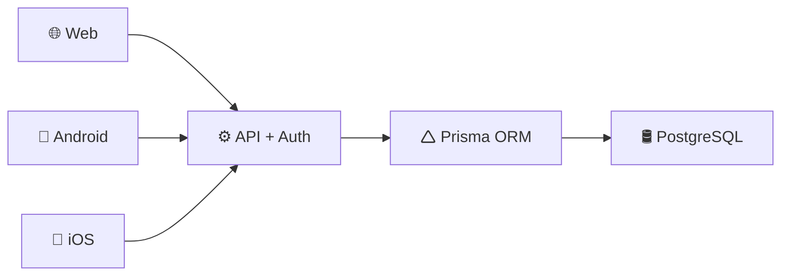

# Pecuária Inteligente: Sistema de Gestão Pecuária

## 1 - Responsáveis

| Papel | Nome | Responsabilidade |
| :--- | :--- | :--- |
| **Coordenador** | Márcio José Moutinho da Ponte | Responsável pela supervisão geral do projeto, alinhamento institucional e acompanhamento do desenvolvimento. |
| **Coordenador Técnico** | Irley Monteiro Araújo | Responsável pela orientação técnica, validação arquitetural e acompanhamento das decisões tecnológicas. |
| **Equipe de Desenvolvimento** | • Alonso Soares   • Felipe Monteiro   • Sandy Soares | Responsável pela análise, implementação, testes e documentação do sistema. |
| **Cliente** | Clayton dos Santos | Responsável pela definição das necessidades do negócio, validação dos requisitos e aprovação das funcionalidades entregues. |

---

## 2 - Descrição do Projeto
O Sistema de Gestão Pecuária é uma plataforma tecnológica integrada (Web, Mobile e IoT) projetada para automatizar, monitorar e otimizar o ciclo produtivo completo de fazendas de pecuária de corte, abrangendo as fases de cria, recria, engorda e abate. O projeto surge para solucionar um dos maiores gargalos do setor agropecuário: a falta de dados precisos e em tempo real sobre o ganho de peso individual dos animais e o manejo ineficiente das pastagens.

---

## 3 - Objetivos de Negócio
- Controlar o ciclo produtivo do animal. 
- Automatizar o manejo de lotes e pastagens. 
- Monitorar ganho de peso. 
- Gerenciar tempo ideal de permanência em pasto. 
- Controlar histórico individual por animal. 
- Fornecer indicadores zootécnicos e financeiros. 
- Permitir rastreabilidade por chip. 

---

## 4 - Principais Funcionalidades
- Gestão de Animais
- Gestão de Lotes 
- Gestão de Pastagens 
- Manejo Rotacionado 
- Controle de Atividades 
- Indicadores Zootécnicos 
- Gestão de Usuários 
- Rastreabilidade por Chip 
- Relatórios e Dashboards 

---

## 5 - Partes Interessadas (Stakeholders)

| Categoria | Descrição | Interesse no Projeto |
| :--- | :--- | :--- |
| **Patrocinador** | Responsável pelo aporte financeiro e viabilidade econômica. | Alinhamento estratégico do software com os objetivos financeiros e ROI do negócio. |
| **Proprietário** | Dono do negócio com macrovisão da fazenda. | Relatórios consolidados, lucratividade por hectare e tomada de decisão de alto nível. |
| **Gerente** | Responsável pelo planejamento tático e coordenação. | Eficiência no cronograma de rotação de pastos, gestão de equipes e ganho de peso dos lotes. |
| **Veterinários** | Corpo técnico consultivo e operacional de saúde animal. | Acompanhamento do histórico clínico individual, controle de vacinas e calendário sanitário. |
| **Técnicos Agrícolas** | Especialistas no manejo da terra e nutrição do rebanho. | Monitoramento da capacidade de suporte das pastagens e tempo de descanso do capim. |

---

## 6 - Atores do Sistema

| Ator | Interface Principal | Descrição / Escopo de Atuação |
| :--- | :---: | :--- |
| **Administrador** | Web | Usuário com permissões totais no sistema. Responsável por especificar os parâmetros globais da plataforma e gerenciar todas as contas de usuários. |
| **Gerente** | Web | Usuário com perfil tático e analítico. Interage com o sistema principalmente para planejar os manejos da fazenda, configurar calendários e analisar dashboards. |
| **Funcionário** | Móvel | Usuário operacional de campo. Trabalha diretamente no curral utilizando o app com suporte nativo *offline-first* para registrar atividades, pesagens e manejos sem dependência de internet. |

---

## 7 - Arquitetura do Sistema

A arquitetura da plataforma segue o modelo de **Arquitetura em Camadas (Layered Architecture)**, priorizando o desacoplamento entre interfaces, escalabilidade, manutenibilidade e centralização das regras de negócio. O sistema adota uma abordagem baseada em uma **API única e centralizada**, responsável por autenticação, autorização, processamento das regras de negócio e acesso seguro aos dados.

A estrutura é dividida em três camadas principais:

### 7.1 Camada de Apresentação (Interfaces com o Usuário)
Responsável pela interação direta com os usuários e dispositivos externos, composta por aplicações independentes que consomem os serviços disponibilizados pela API central:
* **Plataforma Web:** Voltada para operações administrativas, monitoramento estratégico, visualização de indicadores e gerenciamento geral.
* **Aplicativos Móveis (Android/iOS):** Destinados às operações em campo, projetados com suporte à estratégia *offline-first*, permitindo registros locais e sincronização posterior dos dados quando houver conectividade.

### 7.2 Camada de Negócios (API Centralizada e Segurança)
Responsável pela centralização das regras de negócio, processamento de dados e aplicação de segurança. A API intercepta e gerencia as sessões aplicando regras de controle de acesso baseado em funções (**RBAC**), garantindo a conformidade dos acessos aos recursos autorizados.

### 7.3 Camada de Persistência e Acesso a Dados
O **Prisma ORM** atua como camada intermediária, abstraindo as operações de banco de dados através de uma interface tipada e segura. Os dados são armazenados de forma persistente em um banco de dados relacional robusto (**PostgreSQL**), garantindo a integridade referencial de todas as entidades do sistema.

