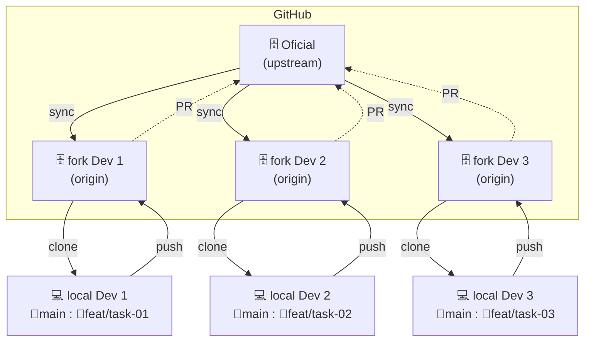

# Guia de Contribuição - iFarm

Este guia descreve o fluxo de trabalho para contribuir com o repositório oficial `ufopa-orixi-devs/ifarm`, usando o modelo de fork.

O fluxo passa por três camadas de repositórios, sendo elas:

| Camada     | O que é                                        | Uso                                                 |
| ---------- | ---------------------------------------------- | --------------------------------------------------- |
| `upstream` | repositório oficial (`ufopa-orixi-devs/ifarm`) | de onde você puxa atualizações e para onde abre PRs |
| `origin`   | seu fork (`seu_usuario/ifarm`)                 | para onde você faz `push`                           |
| `local`    | clone local do fork                            | onde você edita, cria branches e faz commits        |

O diagrama a seguir mostra o fluxo de contribuição via fork do GitHub.



---

## 1 - Configurando o projeto

### 1.1 - Fork e clone

Entre no [github.com](https://github.com), acesse o repositório da organização e clique em `Fork` → `Create a new fork`. Coloque você como **Owner** e marque para copiar apenas a branch `main`. Agora você deve ter o fork na sua conta pessoal.

Clone a partir deste fork:

```bash
git clone git@github.com:seu_usuario/ifarm.git
```

Depois de clonar, vincule o upstream (repositório oficial) à cópia local:

```bash
git remote add upstream git@github.com:ufopa-orixi-devs/ifarm.git
```

---

### 1.2 - Instale o projeto

Instale o projeto de acordo com o `README`.

## 2 - Fluxo de contribuição

### 2.1 - Verifique a task

Vá ao [app.plane.so](https://app.plane.so/) e procure a task (work item) na área **Todo** que foi atribuída a você. Mova a tarefa para a área **In Progress** para indicar que você está trabalhando nela.

Cada task tem um código como `FA-1`. Esse código é importante para identificar a tarefa, por isso vamos colocá-lo no nome da branch no próximo passo.

---

### 2.2 - Crie a branch para a task

Antes de criar a branch, sempre faça uma sincronização:

```bash
git switch main
git fetch upstream
git merge upstream/main
git push origin main
```

Agora crie a branch:

```bash
git switch -c feat/FA-1/descricao-da-feat
```

---

### 2.3 - Implementação da tarefa

Implemente a tarefa. Lembre-se de fazer um commit a cada unidade lógica completa. Você vai passar a maior parte do tempo nesta etapa.

No fim, você precisará fazer pelo menos um:

```bash
git add .
git commit -m "feat: descrição da tarefa implementada"
```

---

### 2.4 - Sincronize novamente e resolva os conflitos

Antes de enviar sua branch, atualize-a novamente com o que houve de novo no repositório oficial, para evitar conflitos na hora do PR:

```bash
git switch main
git fetch upstream
git merge upstream/main
git push origin main
git switch feat/FA-1/descricao-da-feat
git merge main
```

Se houver conflitos, resolva-os agora, localmente, editando os arquivos sinalizados. Depois dessas alterações é necessário um novo commit:

```bash
git add .
git commit -m "chore: conflitos resolvidos"
```

---

### 2.5 - Pull Request

Envie sua branch para o seu fork:

```bash
git push origin feat/FA-1/descricao-da-feat
```

No GitHub, vá até o seu fork. O GitHub vai sugerir automaticamente **"Compare & pull request"** — clique nesse botão (ou vá em **Contribute** → **Open pull request**).

Confirme que está assim:

- **base repository:** `ufopa-orixi-devs/ifarm` &nbsp; **base:** `main`
- **head repository:** `seu_usuario/ifarm` &nbsp; **compare:** `feat/FA-1/descricao-da-feat`

Escreva um título e descrição claros do que foi feito, e crie o PR. O título também deve estar relacionado com a task. Use títulos na forma:

```
feat/FA-1: descrição curta do que foi feito
```

---

### 2.6 - Sinalize a conclusão da tarefa

Por fim, mova a task no Plane de **In Progress** para **Review**.

O revisor vai analisar a solução, podendo mover a tarefa para **Done** (concluída) ou solicitar correções, movendo a tarefa para **In Progress** novamente. No caso de correções solicitadas, a descrição das correções é feita no PR.

---

### 2.7 - Implementando correções

Caso o revisor solicite alterações, faça os ajustes na mesma branch, tomando o cuidado de atualizar a branch e resolver eventuais conflitos antes de enviar a solução corrigida:

```bash
git switch feat/FA-1/descricao-da-feat

# faz os ajustes...

git add .
git commit -m "fix: correção implementada"
```

Sincroniza de novo, resolve os conflitos e envia as correções:

```bash
git switch main
git fetch upstream
git merge upstream/main
git push origin main
git switch feat/FA-1/descricao-da-feat
git merge main

# resolve conflitos se houver...

git add .
git commit -m "chore: conflitos resolvidos"
git push origin feat/FA-1/descricao-da-feat
```

Depois de enviar, mova novamente a tarefa para **Review**.

> As seções 2.6 e 2.7 formam um ciclo de revisão-correção, que se repete até a aprovação do PR.

---

### 2.8 - PR finalizado

Quando o PR for aprovado, ele será **mergeado** ao repositório oficial pelo admin, que também moverá a task para **Done**.

Depois disso, apague a branch da tarefa:

```bash
git switch main
git fetch upstream
git merge upstream/main
git push origin main
git branch -d feat/FA-1/descricao-da-feat
git push origin --delete feat/FA-1/descricao-da-feat
```

Com isso, seu fork está limpo e atualizado para a próxima tarefa.

---

## 3 - Padrão de nomenclatura

- **Branch:** `feat/FA-1/descricao-da-feat`
- **Commits:** seguem [Conventional Commits](https://www.conventionalcommits.org/) (`feat:`, `fix:`, `chore:`, `refactor:`, `docs:`)
- **Título do PR:** `feat/FA-1: descrição curta do que foi feito`
